> **Rapport historique du 19 novembre 2026.** Ses chiffres décrivent cette passe isolée. Pour les fichiers récupérés, les sorties suivantes et les manquants actuels, consulter [la consolidation du 20 novembre](CONSOLIDATION_2026-11-20.md) et [la galerie complète](../../Galerie_Personnages.html).

# Galerie — reprise du 19 novembre 2026

14 références en pied candidates. Chaque aperçu renvoie à un PNG individuel. La fidélité détaillée reste documentée dans le [rapport visuel](VISUAL_QA_2026-11-19.md).

## Anya Stroud — Gears of War 3

[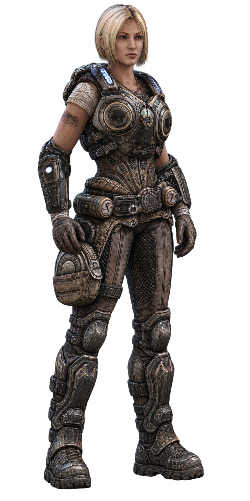](../../assets/characters/anya_stroud/gears3/reference_fullbody_v01.png)

887 × 1774 px · PNG RGBA · version 01.

Source individuelle tronquée ; jambes et bottes à confronter à une référence complète. Marge visible étroite : prévoir un canevas de production plus généreux.

## Queen Myrrah — Gears of War 3

[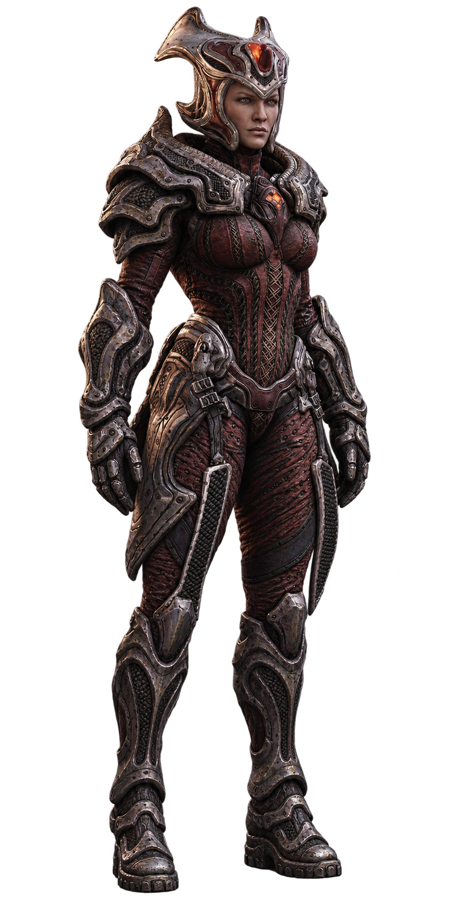](../../assets/characters/myrrah/gears3/reference_fullbody_v01.png)

887 × 1774 px · PNG RGBA · version 01.

Source individuelle tronquée ; protections inférieures à vérifier. Marge visible étroite : prévoir un canevas de production plus généreux.

## Theron Guard — Gears of War 3

[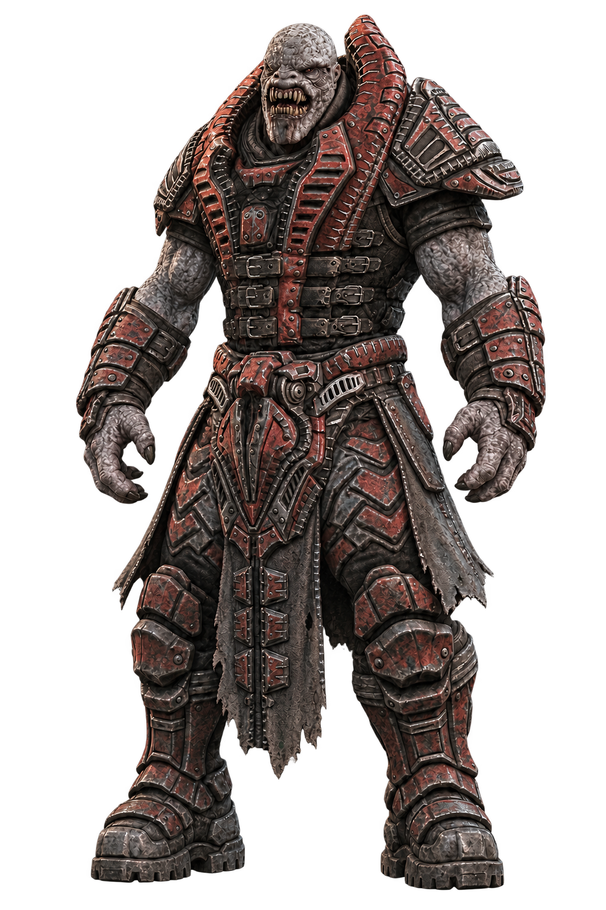](../../assets/characters/theron_guard/gears3/reference_fullbody_v02.png)

1024 × 1536 px · PNG RGBA · version 02.

Variante Gears 3 sans casque ; ne pas la présenter comme une validation Gears 1.

## Fahz Chutani — Gears 5

[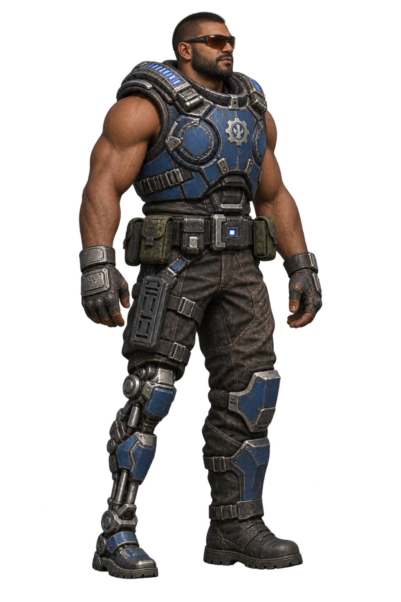](../../assets/characters/fahz_chutani/gears5/reference_fullbody_v01.png)

1024 × 1536 px · PNG RGBA · version 01.

Prothèse de la jambe droite conservée ; visage et détails du plastron limités par la définition de la capture.

## Clayton Carmine — Gears of War 3

[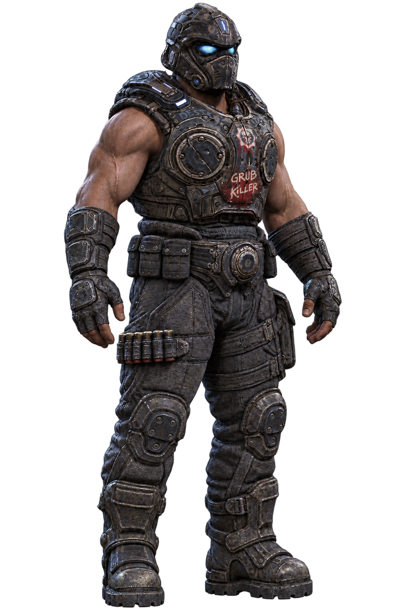](../../assets/characters/clayton_carmine/gears3/reference_fullbody_v02.png)

1017 × 1547 px · PNG RGBA · version 02.

Version v02 : inscription GRUB KILLER corrigée ; bottes et genouillères à vérifier avec une source complète. Marge visible étroite : prévoir un canevas de production plus généreux.

## Victor Hoffman — Armure classique

[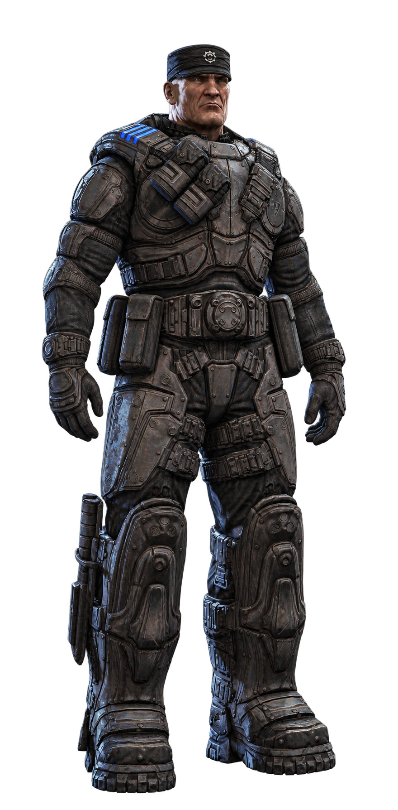](../../assets/characters/victor_hoffman/classic/reference_fullbody_v01.png)

880 × 1788 px · PNG RGBA · version 01.

Apparence classique ; édition native du rendu non établie, ne pas certifier Gears 2.

## Tai Kaliso — Gears of War 2

[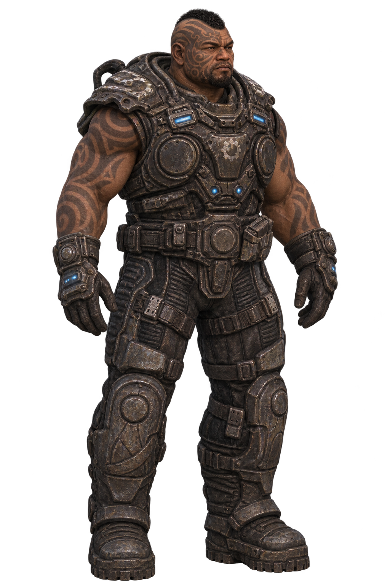](../../assets/characters/tai_kaliso/gears2/reference_fullbody_v01.png)

1024 × 1536 px · PNG RGBA · version 01.

Visage et crête fondés sur une capture Gears 2 ; complément de silhouette issu du concept art, détails inférieurs à vérifier. Marge visible étroite : prévoir un canevas de production plus généreux.

## Samantha Byrne — Gears of War 3

[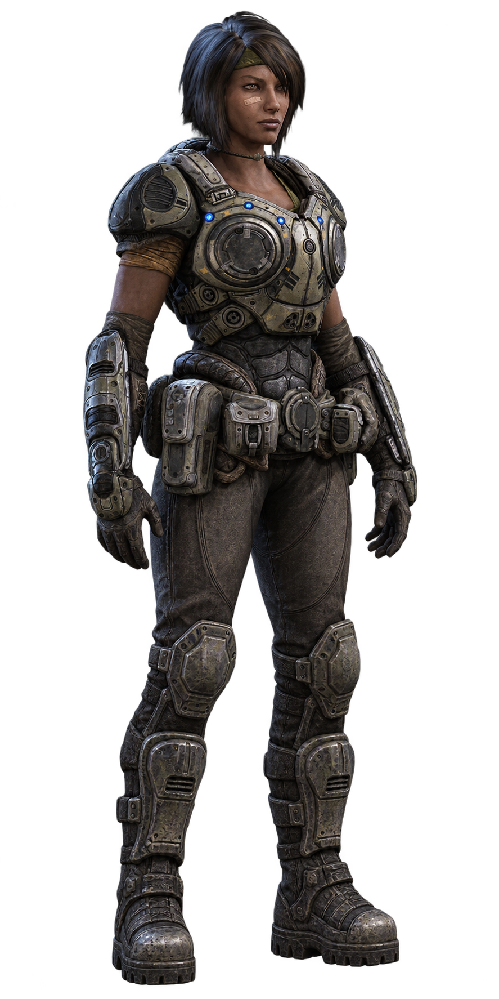](../../assets/characters/samantha_byrne/gears3/reference_fullbody_v01.png)

887 × 1774 px · PNG RGBA · version 01.

Source tronquée ; jambières et bottes à vérifier. Marge visible étroite : prévoir un canevas de production plus généreux.

## Gabriel Diaz — Gears Tactics

[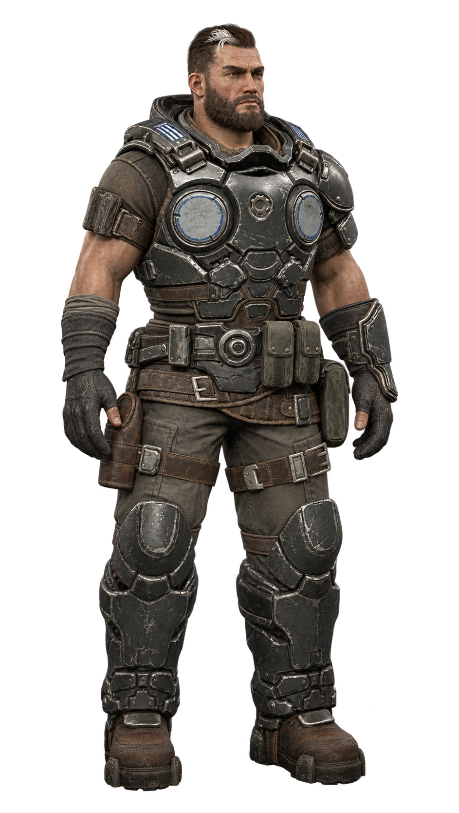](../../assets/characters/gabriel_diaz/tactics/reference_fullbody_v01.png)

943 × 1668 px · PNG RGBA · version 01.

Référence officielle en pied disponible ; petits détails à revalider avant les animations.

## Mikayla Dorn — Gears Tactics

[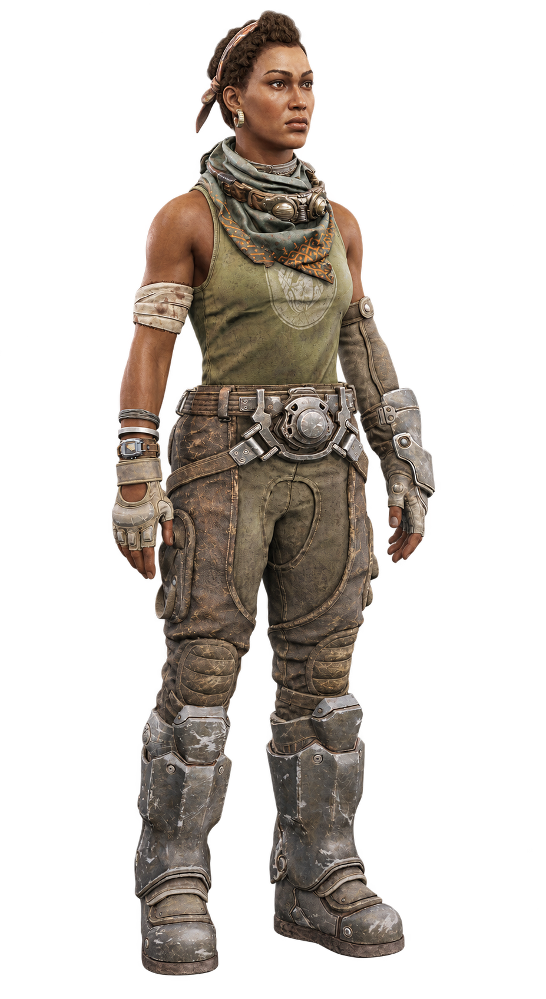](../../assets/characters/mikayla_dorn/tactics/reference_fullbody_v01.png)

927 × 1697 px · PNG RGBA · version 01.

Référence officielle en pied disponible ; conserver les asymétries et les motifs du shemagh. Marge visible étroite : prévoir un canevas de production plus généreux.

## Lahni Kaliso — Gears 5 — Hivebuster / Escape

[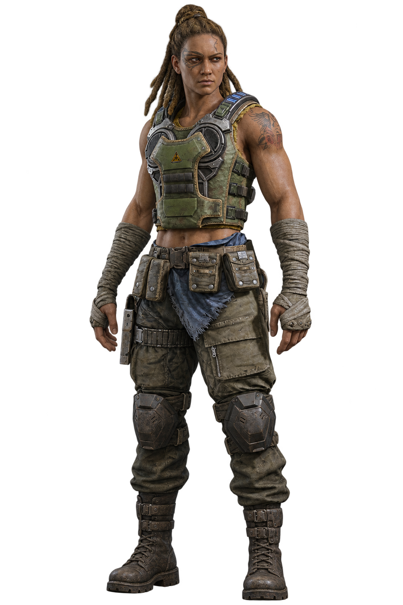](../../assets/characters/lahni_kaliso/gears5_hivebuster/reference_fullbody_v01.png)

1024 × 1536 px · PNG RGBA · version 01.

Tenue Hivebuster / Escape ; pieds non couverts par la fiche officielle, tatouages à contrôler en détail. Marge visible étroite : prévoir un canevas de production plus généreux.

## Mac MacAllister — Gears 5 — Hivebuster / Escape

[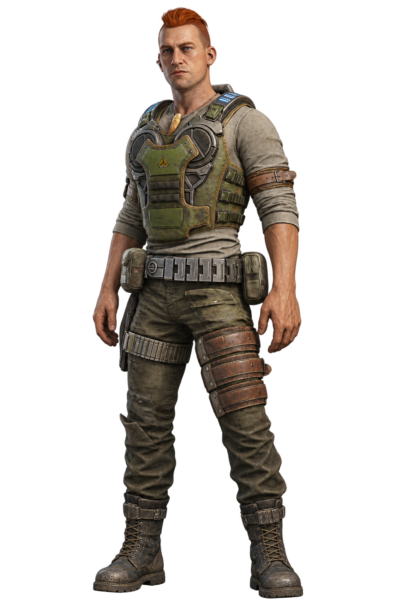](../../assets/characters/mac_macallister/gears5_hivebuster/reference_fullbody_v01.png)

1024 × 1536 px · PNG RGBA · version 01.

Tenue Hivebuster / Escape ; partie inférieure des jambes reconstituée, non certifiée. Marge visible étroite : prévoir un canevas de production plus généreux.

## Warden — Gears 5

[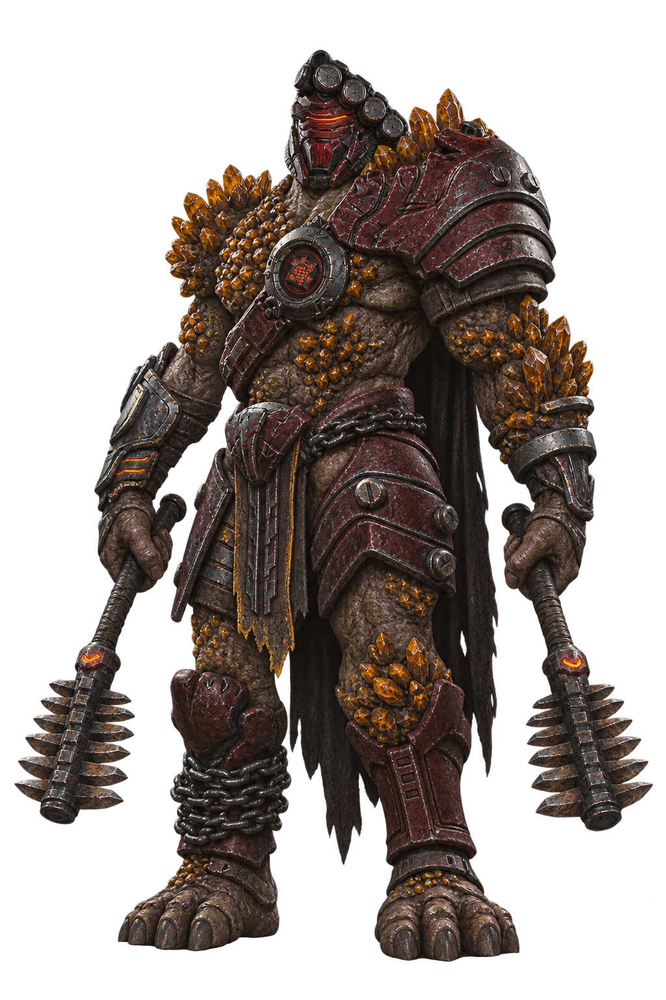](../../assets/characters/warden/gears5/reference_fullbody_v01.png)

1024 × 1536 px · PNG RGBA · version 01.

Casque vérifié sur capture de jeu ; détail des deux Breaker Maces à revalider avec une capture rapprochée. Marge visible étroite : prévoir un canevas de production plus généreux.

## Ukkon — Gears Tactics

[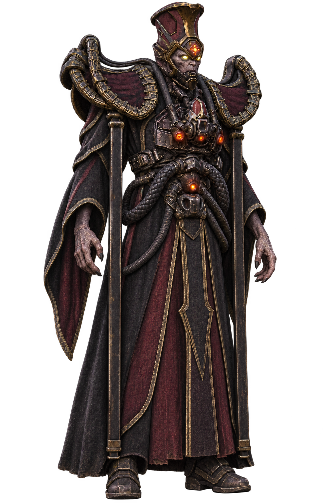](../../assets/characters/ukkon/tactics/reference_fullbody_v02.png)

1024 × 1536 px · PNG RGBA · version 02.

Version v02 : deux rails suspendus allongés vers les chevilles ; détails de la robe et des pieds à contrôler. Marge visible étroite : prévoir un canevas de production plus généreux.
